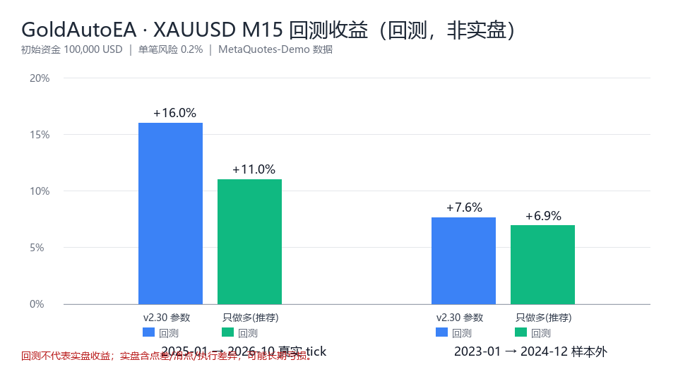
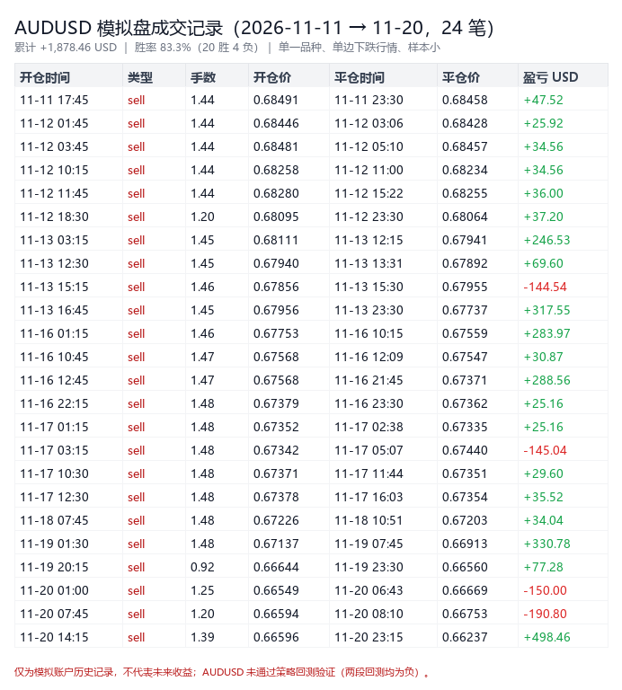
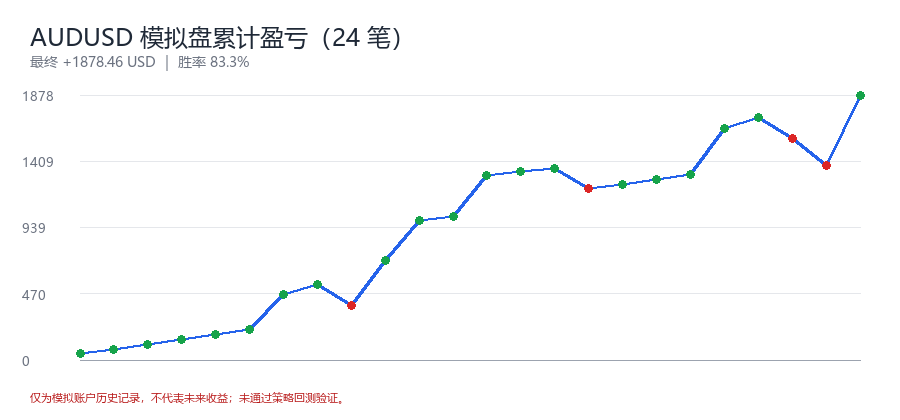

# GoldAutoEA · XAUUSD M15 多因子策略

> **源码私有**：完整 EA 源码（`.mq5` / `.mqh`）与参数文件**不公开**，授权后提供。
> 本仓库仅用于展示策略逻辑、回测结果与版本记录。

---

## 这是什么

GoldAutoEA 是一套面向 **XAUUSD（黄金）M15** 的量化交易策略，运行在 **MetaTrader 5** 上。

核心是一套 **四因子综合评分** 模型，用同一套分数同时决定「开不开仓、开哪个方向、什么时候走」：

| 因子 | 衡量什么 | 通俗解释 |
|---|---|---|
| 趋势 | 快/慢均线距离 | 现在是大方向涨还是跌 |
| 动量 | 最近 N 根涨跌速度 | 有没有劲、动能是否延续 |
| 回归 | 价格离均值多远 | 是不是涨/跌过头了 |
| 突破 | 是否突破近期高低点 | 是否刚走出新区间 |

四个因子经 `tanh` 压缩、按波动率自适应加权，合成 **−1 ~ +1** 的综合评分：

- 评分 **≥ +0.45** → 做多（可配置）
- 评分 **≤ −0.45** → 做空（可配置）
- 评分回到 **±0.08** 以内 → 平仓

## 出场与风控（框架级说明）

- **止损**：2.5 × ATR（随波动自适应）
- **移动止损**：3.5 × ATR，每根 K 线收盘更新
- **时间止损**：36 根 M15（约 9 小时）
- **锁利**：浮盈到 0.5R 时把止损移到 +0.2R，锁定小利润
- **2R 减半**：浮盈到 2R 先平一半，剩余继续持有
- **点差/时段闸门**：点差过大或流动性差的时段不开仓
- **禁追极值**：价格已在通道/布林极值时不开新仓
- **账户级风控**：单笔 0.2%、日亏 1% 停手、最大回撤 10% 停机、同一 Magic 单实例锁

> 具体参数、阈值组合、过滤条件与实现细节属于私有内容，仅授权后提供。

---

## 回测结果

**数据来源**：MetaQuotes-Demo，初始资金 100,000 USD，单笔风险 0.2%，无佣金（仅点差）。

| 区间 | 数据精度 | 版本 | 净收益 | PF | 最大回撤 | 交易数 |
|---|---|---|---|---|---|---|
| 2025-01 → 2026-10 | 真实 tick | v2.30 参数 | **+16.0%** | 1.20 | 3.7% | 842 |
| 2023-01 → 2024-12（样本外） | 1 分钟 OHLC | v2.30 参数 | **+7.6%** | 1.09 | 7.7% | 1,002 |
| 2025-01 → 2026-10 | 真实 tick | 只做多（推荐） | **+11.0%** | 1.23 | 2.6% | 643 |
| 2023-01 → 2024-12（样本外） | 1 分钟 OHLC | 只做多（推荐） | **+6.9%** | 1.14 | 4.4% | 708 |

> - 回测使用历史数据，**不代表未来收益**；
> - 真实账户存在点差扩大、滑点、佣金、执行延迟，结果通常差于回测；
> - 策略依赖少数大盈利单，**胜率约 40–45%，会连续亏损**，不适合追求"天天赚"的人。

### 实盘（模拟盘）记录 · 透明披露

| 区间 | 结果 | 说明 |
|---|---|---|
| 2026-10-21 → 2026-11-10（约 3 周） | **约 −1%** | 样本极小（20 余笔），期间含早期版本 bug（停机锁、时间止损异常）、频繁重挂与手动干预 |

### 多品种适用性（重要）

策略参数是针对 **XAUUSD（黄金）** 的波动特征校准的。我们同时对 **AUDUSD（澳元）** 做了完整回测，结果如下：

| 品种 | 2025-01 → 2026-10（真实 tick） | 2023-01 → 2024-12（样本外） | 结论 |
|---|---|---|---|
| **XAUUSD** | **+6,737**（PF 1.099，胜率 61.9%） | **+3,056**（PF 1.044，胜率 61.3%） | ✅ 通过 |
| **AUDUSD** | **−7,771**（PF 0.859，胜率 57.4%） | **−7,764**（PF 0.891，胜率 58.2%） | ❌ 未通过 |

> 结论：**同一套参数直接迁移到 AUDUSD 是亏损的**——策略与品种强相关（波动率、趋势结构、点差占 ATR 比例都不同）。
> 购买后请**仅用于 XAUUSD**；若想用于其他品种，需要重新调参并做两段验证。

### AUDUSD 模拟盘记录（仅作参考）

| 区间 | 笔数 | 胜率 | 累计盈亏 |
|---|---|---|---|
| 2026-11-11 → 2026-11-20 | 24 | **83.3%** | **+1,878.46** |

> 截图中已隐去订单号等无关信息。
>
> 这段记录**不是策略的有效性证明**：
> - 样本仅 24 笔、时间约 8 个交易日；
> - 期间 AUDUSD 从 0.685 跌到 0.662，属于**单边下跌**，而策略以做空为主，方向恰好一致；
> - 配合"浮盈锁利"机制，表现为"高胜率、小额盈利"；
> - 同期 AUDUSD 的完整回测为 **−7.8%（两段均为负）**，请勿据此认为策略适用于澳元。

> 我们选择公开这段不理想的实盘记录：**短期样本没有统计意义**，但隐瞒它才是真正的不诚实。

---

## 版本更新记录（v2.36 → v2.44）

| 版本 | 日期 | 主要改动 |
|---|---|---|
| v2.36 | 2026-10-24 | 启动时预计算评分，面板不再等待 |
| v2.37 | 2026-10-27 | 修复账户信息未同步导致的"日亏锁"误锁 |
| v2.38 | 2026-10-28 | 默认参数与实盘配置对齐（风险 0.2%、杠杆 1×、日亏 1%） |
| v2.39 | 2026-11-03 | 修复时间止损异常（持仓时间溢出、重复平仓刷屏） |
| v2.40 | 2026-11-03 | 单实例持久锁（多图表不重复接管）；接管时使用存档初始风险 |
| v2.41 | 2026-11-03 | 默认只做多（两段回测更优） |
| v2.42 | 2026-11-03 | 恢复做空开关（可按需切换） |
| v2.43 | 2026-11-10 | 默认开启浮盈锁利 0.5R→0.2R（胜率 46%→62%，收益约 −16%） |
| v2.44 | 2026-11-13 | 面板精简、删减提示文字 |

---

## 适用条件与不适合的人

**适合：**
- 使用 MetaTrader 5（建议 Build 6000+）、对冲账户；
- 交易 **XAUUSD**，点差 ≤ 0.8 美元/盎司；
- 能接受 **10–20% 回撤**、连续 5–10 笔亏损；
- 打算以 **月/季度** 维度评估策略，而不是几天；
- 有 VPS 更佳（减少断线与滑点）。

**不适合：**
- 想"每天稳定小赚"、不能接受回撤；
- 想用马丁/网格/重仓翻本；
- 无法自己部署 EA、也不愿意学习基础 MT5 操作。

---

## 授权与购买

**源码为什么不公开？**
完整源码托管在私有仓库，包含参数配置、风控模块与实验记录。公开会直接削弱授权价值，因此仅向授权用户提供。

**授权内容（标准包）：**
- 完整 EA 源码（`.mq5` / `.mqh`）
- 推荐参数文件（`.set`）
- 部署文档（MT5 安装、挂载、VPS 建议、常见问题）
- 版本更新（有效期内）
- 基础答疑（部署/参数层面）

**价格与授权方式：**
- 个人版 / 商业版（不同使用范围与更新期限）
- 具体报价与授权条款请通过下方联系方式咨询

> 我们**不承诺收益**、不提供代操盘、不卖"信号"。买的是源码与部署能力，盈亏由使用者自行承担。

## 联系方式

- **GitHub Issues**：在本仓库提交 Issue 咨询（公开提问，合适的问题我会整理成 FAQ）

> 提交 Issue 时请说明：用途（自用/商用）、MT5 版本、账户类型（模拟/实盘）、是否已有 VPS；如需私下沟通，可在 Issue 中留下联系方式。

---

## 风险声明

1. 本仓库所有回测数据均为历史模拟，**不代表未来表现**；
2. 外汇/黄金保证金交易风险极高，可能导致本金全部损失；
3. 策略在震荡市、点差扩大、重大新闻期间可能连续亏损；
4. 本仓库仅作策略展示与研究交流，**不构成投资建议**；
5. 使用本策略产生的任何盈亏，由使用者自行承担。

---

*最后更新：2026-11-21 · 当前版本 v2.44*
